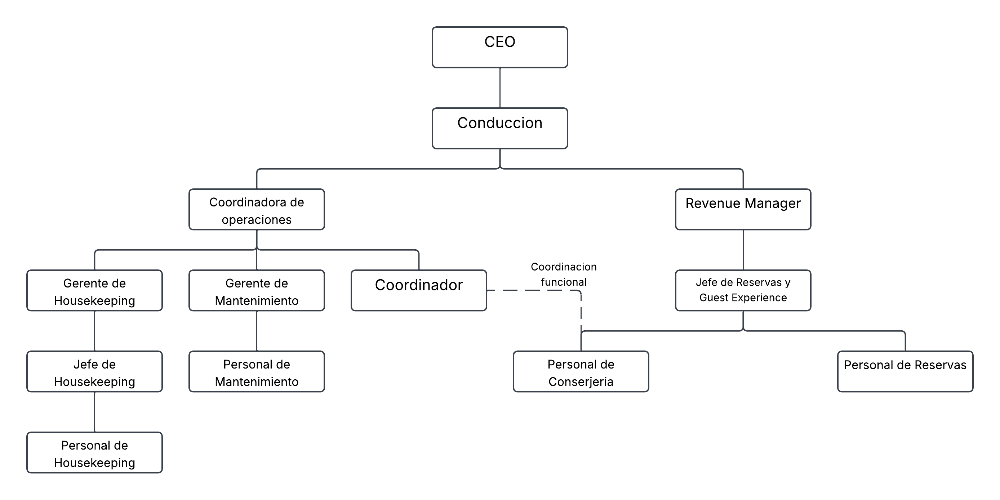

# Organigrama de Almarena La Reserva

## Estructura organizacional

El siguiente organigrama representa la estructura jerárquica formal de Almarena La Reserva, contemplando los cargos corporativos de Grupo Almarena que intervienen en su funcionamiento y las áreas operativas vinculadas al complejo.

## Descripción de la estructura

La estructura organizacional está encabezada por el CEO, seguido por el Jefe de Conducción. De este último dependen la Coordinadora de Operaciones y el Revenue Manager.

La Coordinadora de Operaciones supervisa las áreas operativas, entre ellas Housekeeping, Mantenimiento y la Coordinación de Almarena La Reserva.

Por otro lado, el Revenue Manager supervisa a la Jefa de Reservas, quien tiene autoridad jerárquica sobre el personal de Reservas y Conserjería.

Debido a cuestiones presupuestarias, las funciones de Reservas y Conserjería son desempeñadas por los mismos empleados, aunque constituyen funciones diferenciadas.

El Coordinador de Almarena La Reserva mantiene una relación de coordinación funcional con el personal de Reservas y Conserjería, pero no posee autoridad jerárquica formal sobre ellos.

**Alcance:** El organigrama contempla los cargos y áreas relevantes para el funcionamiento de Almarena La Reserva. No representa la totalidad de las áreas de soporte corporativo de Grupo Almarena.
