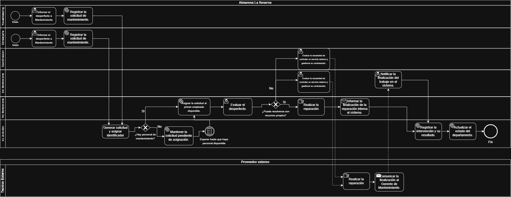

# Proceso de gestión de mantenimiento

## Descripción

El proceso comienza cuando Housekeeping o Conserjería
detectan un desperfecto en un departamento.

## Participantes

- Housekeeping
- Conserjería
- Coordinación de ALR
- Gerencia de Mantenimiento
- Personal de Mantenimiento
- Sistema de gestión
- Proveedor externo

## Diagrama BPMN 2.0 

